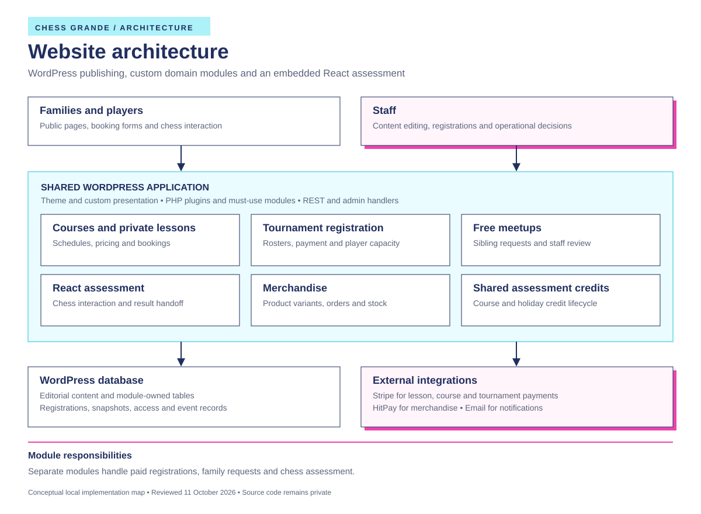
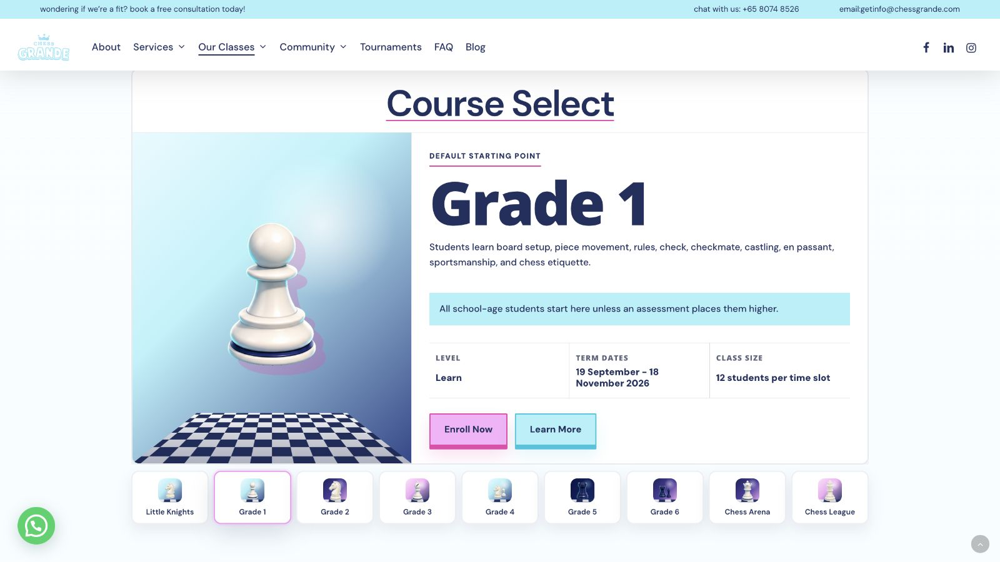
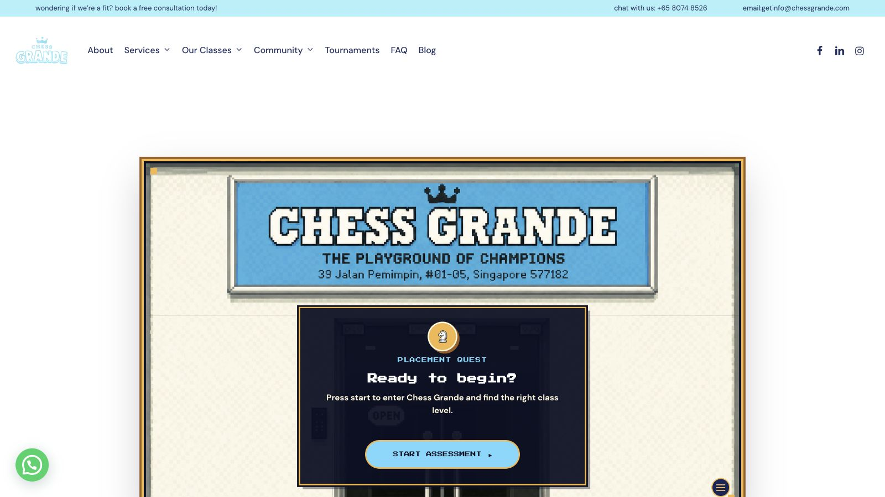
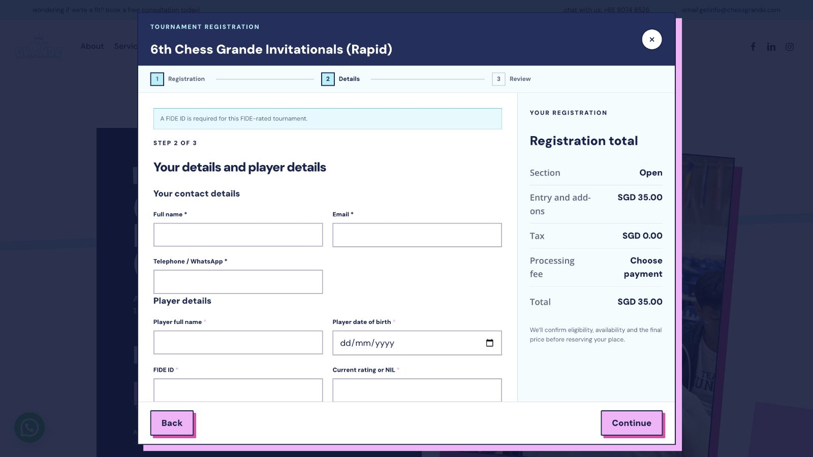
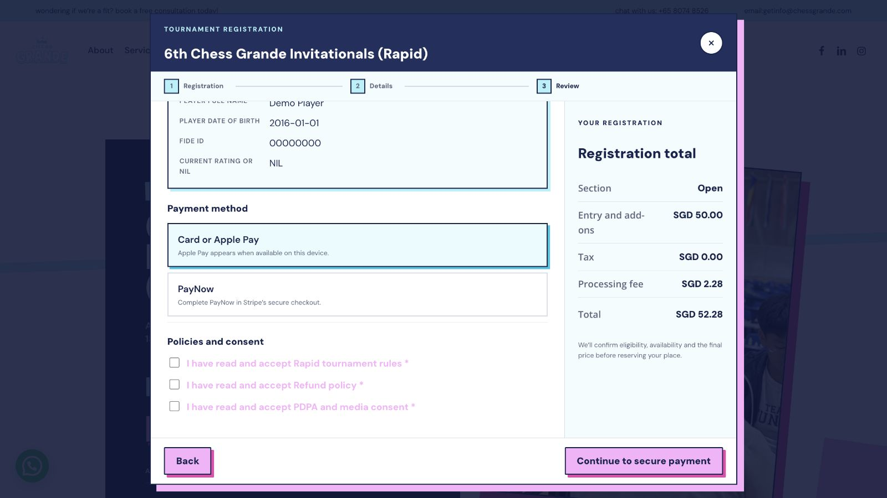

# Chess Grande website architecture

Chess Grande combines a chess academy website with booking, assessment, event registration, and staff operations. WordPress handles publishing and administration. Custom PHP modules implement business rules. React handles the interactive chess assessment.

This is a documentation-only architecture showcase. The application source code is private. The diagrams describe the inspected implementation at a conceptual level; inclusion of a module does not imply that its latest local version is deployed.

[Visit Chess Grande](https://chessgrande.com/) · [System design](architecture/system-design.md) · [Registration flows](architecture/registration-flows.md) · [Engineering decisions](architecture/engineering-decisions.md)

## Website screenshots

Public website captures taken on 11 October 2026 at a 1600 × 900 viewport. These show the displayed pages, not completed booking or payment tests.

### Courses

Course page with the class pathway and assessment links. [View page](https://chessgrande.com/courses/)

### Course selector

Grade selection with term dates, class size and the enrolment link. [View page](https://chessgrande.com/courses/#courseSelect)

### Tournaments

Tournament page with the event directory entry point and photo gallery. [View page](https://chessgrande.com/tournaments/)

### Assessment

Entry screen for the React placement assessment. [View page](https://chessgrande.com/assessments/)

### Tournament registration

Contact and player details alongside the registration total. [View tournament](https://chessgrande.com/tournaments/6th-chess-grande-invitationals-rapid/)

### Checkout review

Checkout review with sample player details, Card or Apple Pay and PayNow options, processing fees and the final total. This is the website’s review screen before Stripe checkout. No registration was submitted and no payment was made. [View tournament](https://chessgrande.com/tournaments/6th-chess-grande-invitationals-rapid/)

## Requirements

Families need to choose suitable classes, request assessments, book programmes, and register children for events. Staff need editable schedules and regulations, reliable payment records, capacity controls, and registration tools within the same website. The public [course pathway](https://chessgrande.com/courses/), [tournament directory](https://chessgrande.com/tournaments/), and [meetup page](https://chessgrande.com/chess-meetups/) are entry points into these services.

Each service has different rules. A four-player tournament team consumes four player slots. A free meetup request requires a family allocation decision. A payment receipt and a completed team assignment represent different states.

## Architecture

The implementation is a modular WordPress application: its PHP modules share a runtime and database while owning distinct workflows. Some features use conventional plugins; site-wide presentation and private-lesson integrations also use must-use plugins, which WordPress loads automatically.

| Area | Implementation responsibility |
| --- | --- |
| Publishing and presentation | WordPress, Salient, page-builder content, custom templates, CSS and JavaScript |
| Courses and holiday programmes | Terms, class slots, booking requests, pricing and Stripe checkout |
| Private lessons | Lesson-package commerce, with presentation versions reusing shared backend classes |
| Tournaments | Event configuration, regulations, roster validation, pricing, player capacity and staff registration tools |
| Free meetups | Parent or guest access, sibling requests, staff decisions and queued email |
| Assessment | React chess interaction, chess rules, result summary and assessment-request handoff |
| Merchandise | Product variants, stock-aware orders and HitPay payment integration |
| Shared assessment credits | One-time entitlement validation, reservation, redemption and release for course and holiday bookings |

## Implementation

- **Server validation.** Tournament eligibility, roster size, prices and capacity are derived from configuration and checked on the server.
- **Payment reconciliation.** The tournament handler verifies webhook signatures and matches payment details against the stored registration before marking it paid.
- **Capacity checks.** Tournament reservations count players; meetup acceptance checks whether the whole family fits.
- **Registration status.** Payment, fulfilment and team assignment can be tracked independently.
- **Registration snapshots.** Tournament records retain event, participant, pricing and policy snapshots.
- **React assessment.** The chess assessment runs within WordPress and passes its result to a separate request form.

## Documentation

1. [System design](architecture/system-design.md) explains module boundaries, storage and external services.
2. [Registration flows](architecture/registration-flows.md) traces tournament payment, meetup acceptance and the assessment handoff.
3. [Engineering decisions](architecture/engineering-decisions.md) explains the practical benefits and maintenance tradeoffs.

This folder contains documentation, diagrams and public website screenshots. It includes no application code, database exports, credentials, customer records or repository history.
