# Registration flows

## Tournament payment

The tournament workflow treats payment as a verified server event. The browser return page reads registration status; reaching it is not itself proof that the registration has been paid.

```mermaid
%%{init: {"theme": "base", "themeVariables": {"background": "#ffffff", "fontFamily": "DM Sans, Avenir Next, Arial, sans-serif", "primaryColor": "#eafcff", "primaryTextColor": "#212f5f", "primaryBorderColor": "#212f5f", "secondaryColor": "#fff5fb", "secondaryTextColor": "#212f5f", "secondaryBorderColor": "#bd176f", "tertiaryColor": "#ffffff", "tertiaryTextColor": "#212f5f", "tertiaryBorderColor": "#212f5f", "lineColor": "#212f5f", "textColor": "#212f5f", "mainBkg": "#eafcff", "nodeBorder": "#212f5f", "clusterBkg": "#ffffff", "clusterBorder": "#1bc4df", "edgeLabelBackground": "#ffffff", "actorBkg": "#eafcff", "actorBorder": "#212f5f", "actorTextColor": "#212f5f", "actorLineColor": "#212f5f", "signalColor": "#212f5f", "signalTextColor": "#212f5f", "noteBkgColor": "#fff5fb", "noteBorderColor": "#bd176f", "noteTextColor": "#212f5f", "labelBoxBkgColor": "#fff5fb", "labelBoxBorderColor": "#bd176f", "labelTextColor": "#212f5f", "sequenceNumberColor": "#ffffff"}}}%%
sequenceDiagram
    actor Parent
    participant App as Tournament backend
    participant DB as Registration storage
    participant Stripe
    participant Mail as Confirmation queue
    Parent->>App: Submit entry and participant details
    App->>App: Validate roster, eligibility and policies; recalculate price
    App->>DB: Acquire event lock; check player capacity
    DB-->>App: Create or reuse registration and hold
    App->>Stripe: Create Checkout Session with idempotency key
    Stripe-->>App: Hosted checkout URL
    App-->>Parent: Redirect to checkout
    Parent->>Stripe: Complete payment
    Stripe->>App: Signed payment event
    App->>App: Verify signature and stored order details
    App->>DB: Claim event; mark paid once; update fulfilment
    App->>Mail: Queue confirmation
    Parent->>App: Read status using opaque token
    App-->>Parent: Current registration state
```

This diagram shows the paid success path; webhook arrival and the browser return can occur in either order. Failure, expiry, asynchronous payment and refund events follow separate branches. Zero-cost entries bypass Stripe while retaining the registration workflow.

The backend calculates capacity in player units. A complete team occupies its roster size, while an individual occupies one slot. The reservation routine checks event and section limits inside a database advisory lock and records snapshots of the relevant registration context.

Webhook validation checks the session and order references, amount, currency, payment mode and selected payment method. Event claiming and a conditional paid transition handle repeated delivery. Processing exceptions release the event claim for a later retry. These are implemented safeguards, not a claim of exactly-once delivery across the entire system.

Payment and fulfilment remain separate. A paid individual entrant in a team event can still need staff to assign a team and board.

## Free meetup requests

```mermaid
%%{init: {"theme": "base", "themeVariables": {"background": "#ffffff", "fontFamily": "DM Sans, Avenir Next, Arial, sans-serif", "primaryColor": "#eafcff", "primaryTextColor": "#212f5f", "primaryBorderColor": "#212f5f", "secondaryColor": "#fff5fb", "secondaryTextColor": "#212f5f", "secondaryBorderColor": "#bd176f", "tertiaryColor": "#ffffff", "tertiaryTextColor": "#212f5f", "tertiaryBorderColor": "#212f5f", "lineColor": "#212f5f", "textColor": "#212f5f", "mainBkg": "#eafcff", "nodeBorder": "#212f5f", "clusterBkg": "#ffffff", "clusterBorder": "#1bc4df", "edgeLabelBackground": "#ffffff", "actorBkg": "#eafcff", "actorBorder": "#212f5f", "actorTextColor": "#212f5f", "actorLineColor": "#212f5f", "signalColor": "#212f5f", "signalTextColor": "#212f5f", "noteBkgColor": "#fff5fb", "noteBorderColor": "#bd176f", "noteTextColor": "#212f5f", "labelBoxBkgColor": "#fff5fb", "labelBoxBorderColor": "#bd176f", "labelTextColor": "#212f5f", "sequenceNumberColor": "#ffffff"}}}%%
flowchart LR
    access[Parent magic link or guest access] --> request[Submit sibling request]
    request --> checks[Server opening and duplicate checks]
    checks --> pending[Pending staff review]
    pending --> review[Verify claims and decide]
    review --> accepted[Accept whole family if capacity permits]
    review --> waitlist[Waitlist]
    review --> rejected[Reject]
    accepted --> outbox[Commit decision and email outbox entry]
    waitlist --> outbox
    rejected --> outbox
    outbox --> delivery[Scheduled delivery with retry]
    classDef operations fill:#fff5fb,stroke:#bd176f,color:#212f5f;
    class review,outbox,delivery operations;
```



Saved households and guest requests have different access models. Parent magic links and sessions use hashed tokens; guest access is scoped to the request. A student-status declaration remains a claim until staff verify it.

The acceptance routine locks the relevant database rows within a transaction and checks the number of children against available capacity. It records the decision, audit entry and queued email before committing. A separate scheduled worker attempts email delivery and delays retries after a failure. Delivery is not a guarantee that a message reached the recipient’s inbox.

## Assessment handoff

```mermaid
%%{init: {"theme": "base", "themeVariables": {"background": "#ffffff", "fontFamily": "DM Sans, Avenir Next, Arial, sans-serif", "primaryColor": "#eafcff", "primaryTextColor": "#212f5f", "primaryBorderColor": "#212f5f", "secondaryColor": "#fff5fb", "secondaryTextColor": "#212f5f", "secondaryBorderColor": "#bd176f", "tertiaryColor": "#ffffff", "tertiaryTextColor": "#212f5f", "tertiaryBorderColor": "#212f5f", "lineColor": "#212f5f", "textColor": "#212f5f", "mainBkg": "#eafcff", "nodeBorder": "#212f5f", "clusterBkg": "#ffffff", "clusterBorder": "#1bc4df", "edgeLabelBackground": "#ffffff", "actorBkg": "#eafcff", "actorBorder": "#212f5f", "actorTextColor": "#212f5f", "actorLineColor": "#212f5f", "signalColor": "#212f5f", "signalTextColor": "#212f5f", "noteBkgColor": "#fff5fb", "noteBorderColor": "#bd176f", "noteTextColor": "#212f5f", "labelBoxBkgColor": "#fff5fb", "labelBoxBorderColor": "#bd176f", "labelTextColor": "#212f5f", "sequenceNumberColor": "#ffffff"}}}%%
flowchart LR
    config[WordPress quiz configuration] --> quiz[React quiz and chess interaction]
    quiz --> result[Score and recommendation summary]
    result --> event[Browser completion event]
    event --> form[Assessment request form]
    form -->|Visitor submits| backend[Course-booking request handler]
    backend --> record[Assessment request record]
    classDef stored fill:#fff5fb,stroke:#bd176f,color:#212f5f;
    class backend,record stored;
```



The quiz interaction and the contact request are separate steps. The request form receives the result summary; it does not need to submit the full move-by-move interaction history. The current frontend clears old saved progress when mounting. Previous attempts cannot be resumed through that saved progress.
