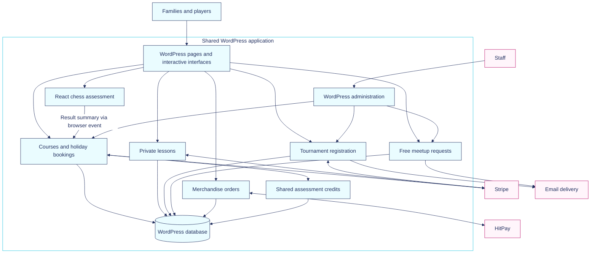

# System design

## Application boundaries

WordPress handles content, administration and request routing. Custom modules extend that foundation with booking and registration workflows. These modules share hosting and database infrastructure, so a plugin boundary is an organizational boundary rather than an independent service deployment.

Arrows show the principal relationships, not every administration or notification route. Payment-provider connections include outbound checkout creation and incoming payment events. The free-meetup workflow has no payment-provider dependency.

## Data ownership

| Domain | Main records | Design purpose |
| --- | --- | --- |
| Editorial content | WordPress pages, posts, media and configuration | Keep publishing in familiar staff tools |
| Courses and holidays | Terms, courses, slots, requests and payment-event records | Model schedules and bookings explicitly |
| Tournaments | Event posts/configuration, registrations and payment-event records | Connect editable event details to traceable registrations |
| Meetups | Event content/state, parents, children, sessions, requests, audit and email outbox | Support family access, staff decisions and deferred delivery |
| Merchandise | Product content, variants, orders and order items | Separate product presentation from stock and order state |
| Assessment credits | Entitlements and reservation/redemption state | Coordinate one-time credits across participating booking modules |

These are logical record groups, not a database schema export. The application combines WordPress content storage with domain-specific tables. It does not require every workflow to fit into a generic post or a single universal order model.

## Frontend composition

The site combines theme and page-builder presentation with custom templates, shortcodes and frontend assets. The assessment uses React, react-chessboard and chess.js, bundled with Vite for WordPress to serve. The rest of the application does not need to become a React single-page app to support that interaction.

The assessment publishes a browser event containing the result summary. The course-booking interface listens for it and includes the summary when a visitor submits an assessment request. Browser-computed scores are advisory input, not a trusted certification of skill.

## Deployment and configuration

The project uses Local for development and documents WP Engine as its production host. Payment credentials belong in protected server configuration, separate from editable WordPress content and exported site data. Production webhook signing secrets are associated with their own handlers; local development listeners have separate configuration.

Server paths, account identifiers, endpoint inventories and secret names are excluded from this documentation.
